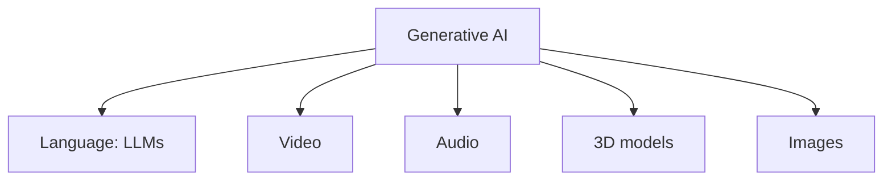

# Lecture 01: Series Introduction

> This is a "why are we doing this" lecture. No technical content yet, so these notes are short. Real material starts in Lecture 02.

## If you remember only five things

1. The course builds an LLM **from scratch**, assuming nothing, so you understand the nuts and bolts and not just how to call an API or run a Colab notebook.
2. The reference book is Sebastian Raschka's _Build a Large Language Model (From Scratch)_. Every part of it gets converted into video lectures.
3. The instructor's complaint: most courses are either app-building (LangChain-style), short crash courses, or too advanced (Karpathy), so nothing teaches the foundations in depth.
4. The real payoff is **interviews**. If someone asks about query/key/value or positional embeddings, you can say you built it yourself.
5. Everything is free, with detailed handwritten lecture notes. He expects 35 to 60 videos in total.

## Who is teaching

Dr. Raj Dandekar (Vizuara). B.Tech in mechanical engineering from IIT Madras (2017), then a PhD in machine learning from MIT (2022). He came back to India with the aim of making AI accessible to everyone. Vizuara's teaching style is to start from the basics and explain the nuts and bolts of every concept.

## The motivation, in the order he argues it

### 1. The field is moving fast, and it's a good time to learn it

- **ELIZA (1960s)** was one of the first chatbots, built to act as a therapist. He types in a question and it just echoes his words back with generic replies, and the conversation goes nowhere. That was the state of NLP 50 to 60 years ago.
- **ChatGPT today**, given the same question, returns books, online courses and research papers, which is exactly what he wanted.
- **Open source is catching up.** He shows a graph of closed vs open source model performance:
    - In 2022 things were mostly closed.
    - GPT-4 (2023) blew everyone away but was closed.
    - By 2024 the gap is shrinking, and Llama 3.1 (Meta) performs at roughly GPT-4 level while being open. (He also mentions the 405B size, though the transcript garbles it.)
    - Open source here means the architecture and weights are public, whereas OpenAI keeps the weights and the details closed.
    - His point is that everything you need to learn is now public, so you only need to be willing to learn it.

`[check video: open vs closed source performance graph]`

### 2. Generative AI is bigger than LLMs

People mix these up. **Generative AI is the broad category** (text, video, audio, 3D, images), and **LLMs are the language part of it.** He shows realistic AI-generated videos, none of which were shot on a camera.

### 3. Real products and real jobs

- Vizuara has its own LLM app for schools. Teachers type a topic like "gravity" and it generates multiple-choice questions within seconds. He says this was unimaginable 4 to 5 years ago.
- He shows a chart of the global generative AI job market, projected to grow about **5 to 6 times in the next 5 years**.

`[check video: job market projection chart]`

## What's wrong with the existing material

He searched Google and YouTube for ways to learn how to build an LLM and found:

| What he found                        | Why it didn't work for him                                                                    |
| ------------------------------------ | --------------------------------------------------------------------------------------------- |
| "Build LLM apps" courses             | About app development, so they never teach how an LLM is built                                |
| "Master LLM concepts" courses        | A quick crash course with no depth                                                            |
| A YouTube playlist, 18 chapters      | Each chapter is only 10 to 15 minutes                                                         |
| Karpathy's "Let's build GPT"         | Quite complex and not for beginners, starts in the middle of a concept, only about 90 minutes |
| A "create an LLM from scratch" video | He tried it and finished 3 hours of it, but it wasn't explained from the basics               |

What he wanted was a deep technical course that starts from the very basics, and none existed, so he is making it.

## The plan for the course

- **Reference:** Raschka's book. He found it one of the best on LLMs, bought it, and is converting every part of it into videos.
- **Scale:** the transcript says 35, 40 or maybe 50 videos in one place and 50 to 60 in another, with lecture notes of 200 to 300 pages in the end. He says he will make notes and videos at the same time to stay on track.
- **Notes:** handwritten whiteboard notes for every lecture. The next two (intro to LLMs, stages of building an LLM) are already done.
- **Prerequisites:** none. Nothing is assumed and everything is spelled out.
- **Price:** free.

> The transcript says the book is "48 pages", which is almost certainly a transcription error, since the book is far longer. I'm ignoring that number.

## Why not just build apps with LangChain?

LangChain helps you build LLM apps, but it isn't much use if you don't know how an LLM works. His view is that jumping straight to deploying apps (cloning a GitHub repo, running a notebook) is the wrong way to learn. Once you've built the model yourself, he says, all the application work later starts to look very easy.

## The interview angle

This is the part to remember for later. If you've only deployed apps by cloning repos and someone asks a detailed question on **key, query and value** or **positional embeddings**, you're stuck. If you've built it from scratch, you know the details better than most people. That is the real goal of the course.

## What's next

Lecture 02 covers the introduction to large language models, using the whiteboard notes he showed at the end of this lecture.

---

_Transcript fixes: "viua" = Vizuara, "Elisa" = ELIZA, "Lama" = Llama, "Andre karpat" = Andrej Karpathy, "rashka" = Raschka._
