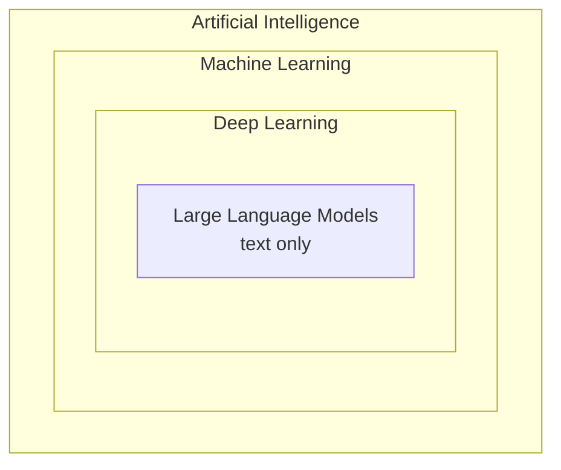

# Lecture 02: Large Language Model (LLM) Basics

This lecture is all theory, with no code. He builds up the basic vocabulary of the field in six parts:

1. What an LLM is
2. What "large" means
3. How LLMs differ from older NLP models
4. The "secret sauce" behind LLMs
5. How LLM, generative AI, deep learning, machine learning and AI relate to each other
6. What you can do with LLMs

## If you remember only five things

1. An LLM is a **deep neural network trained on a huge amount of text** so it can understand, generate and respond to human-like text.
2. "Large" refers to the **number of parameters**: billions now, and trillions for some models. Before LLMs, models were far smaller.
3. Older NLP models were built for **one specific task** (translation, sentiment, and so on). One LLM can do a wide range of language tasks.
4. The secret sauce is the **Transformer architecture**, from the 2017 paper _Attention Is All You Need_. The whole series builds toward it.
5. AI ⊃ Machine Learning ⊃ Deep Learning ⊃ LLMs. Generative AI is deep learning that creates new content in any medium (text, images, audio, video), and LLMs are its text-only part.

---

## 1. What is an LLM?

His simplest definition: **an LLM is a neural network designed to understand, generate and respond to human-like text.** Two parts of that need unpacking.

**"Neural network."** The usual picture is input data feeding into a layer of neurons, several such layers stacked together, then an output layer. The name comes from the loose resemblance to circuitry in the brain (he stresses it's only a symbolic resemblance). Deep neural networks are used for many things: image detection, text generation, self-driving cars, detecting whether a patient has a brain tumor. An LLM is just a neural network designed for the broad family of text tasks.

**"Understand, generate and respond to human-like text."** He shows this with ChatGPT:

- He picks a starter prompt: help me plan a relaxing day, but first ask me what forms of relaxation I like.
- ChatGPT asks back, offering examples like outdoors, reading, yoga, painting or cooking.
- He answers "reading a book," and it builds a plan around that: morning meditation (30 min), healthy breakfast (45 min), reading time (2 hours), nature walk (1 hour).

The point is that it feels like talking to a human. It followed the instruction, asked a sensible question, and adapted to the answer.

> The answer to give when someone asks what an LLM is: _a deep neural network trained on a massive amount of data, to understand, generate and respond to human-like text._ ChatGPT is an LLM, but at its core it's "just" a neural network doing these tasks, and people often forget that.

He adds that LLMs sound more human by the month, and that this causes real problems, which he says might get a separate series.

---

## 2. Why "large" language model?

**Large** means the number of **parameters**, which is the model's size. Before LLMs, models weren't big. LLMs have billions of parameters, and some now have trillions.

He backs it up with visuals:

`[check video: table of GPT-3 variants and their sizes]`

| Model        | Parameters  |
| ------------ | ----------- |
| GPT-3 small  | 125 million |
| GPT-3 medium | 350 million |
| GPT-3 large  | 760 million |
| GPT-3 13B    | 13 billion  |
| GPT-3 175B   | 175 billion |

The number in the name is the parameter count, so "175B" means 175 billion. GPT-4 has even more.

`[check video: GPT-1 vs GPT-2 vs GPT-3 comparison graph]`

The GPT-1 → GPT-2 → GPT-3 comparison shows the models getting better as they get bigger:

- Parameters: about 100 million for GPT-1, 1.5 billion for GPT-2, 175 billion for GPT-3. He fumbles the multipliers a bit, but the jump from GPT-2 to GPT-3 is roughly 100x.
- Decoders (layers): 12, then 48, then 96.
- "Token size": 512, then 1024, then 2048. (He says this is something we'll learn properly later, and I suspect it's what's usually called the context length. I'll flag it when the lecture covers it.)

He doesn't explain decoders or token size yet. The only point here is that everything grows from one generation to the next.

`[check video: Nature graph of AI model size from 1950 to 2022]`

There's also a graph from _Nature_ of model size across AI from 1950 to 2022. The y-axis is a **log scale**. Early models had tiny parameter counts (the transcript is garbled here, but roughly thousands). Around 1980 to 2000 models reached about 100,000 parameters. Only around 2020 did the jump come to hundreds of millions, billions, and close to a trillion, and the largest points are the orange ones (language models).

**Why "language"?** Because these models only deal with **language**, not other modalities like images or video. Within language they handle many tasks: question answering, translation, sentiment analysis and more.

---

## 3. Why have LLMs become so popular? (LLMs vs earlier NLP)

NLP existed long before LLMs, so what changed? He gives two differences.

**1. Specific vs general.** Earlier NLP models were designed for one task, for example one model for translation and a different one for sentiment analysis. An LLM is general: train a GPT on text completion and the same architecture turns out to work for translation too.

**2. What they can do in practice.** Earlier language models couldn't do something like **write an email from custom instructions**, which was very hard for them. For ChatGPT it's trivial. He asks it to draft an email to a friend about booking movie tickets, and it writes the whole thing, even adding emojis.

So LLMs are broad and their applications are close to endless, which is why this playlist exists.

---

## 4. The secret sauce: the Transformer

He admits people usually say "there's no secret sauce, things just improve gradually," but in this case there is one: **the Transformer architecture**.

If your only picture of a Transformer is the movie with the car-robots, that's fine, he says, and this playlist is for you.

`[check video: the Transformer schematic]`

The schematic he shows has parts like input embedding, multi-head attention, feed forward, "Add & Norm" and output embedding. You are not expected to understand any of it yet.

It comes from one paper:

- **_Attention Is All You Need_**, published in **2017** by **eight authors at Google Brain**
- 15 pages, and the paper introduced the Transformer
- more than **100,000 citations** within about 5 years, which he points out as an example of research with a huge reward
- very dense. He says YouTube explanations don't do it justice, and that each page could take **3 to 4 videos** to explain properly

The sections he'll devote lectures to later include **positional encoding, dot-product attention, the attention formula, key/query/value, and multi-head attention.** For now, just keep the schematic in mind.

---

## 5. AI vs ML vs DL vs LLM vs Generative AI

The terminology gets confusing, so he organizes it as **nested umbrellas**.

`[check video: the nested-umbrella figure]`

Going from the outside in:

**AI (the biggest umbrella).** Any machine that behaves in any way like a human or shows some intelligence. His example is the **Lufthansa flight chat assistant**. It's a **rule-based** chatbot: you pick from a set of options (like "flight cancelled, check alternatives and rebook") and it answers in a programmed way. It doesn't learn from you, and it behaves the same for you and your friend. So it's AI, but not machine learning.

**ML (inside AI).** Machines that **learn and adapt** from data and from how users interact with them. It covers neural networks _and other methods_.

**DL (inside ML).** The part of machine learning that uses **neural networks**. His way of drawing the line between ML and DL is with examples:

- **Decision tree for predicting heart disease.** Imagine data from 303 patients, with age, gender, chest pain, cholesterol, ECG and so on. You build a decision tree to predict whether someone has heart disease. There's no neural network anywhere, so it's ML but **not** DL.
- **CNN for image recognition.** A convolutional neural network with filtering layers looks at a coffee cup image and outputs probabilities over classes, with the top probability on the correct class (the transcript doesn't capture the exact label). That's a neural network, so it's **DL**.
- **Handwritten digit classification.** A neural network with an input layer, two hidden layers and an output layer, trained on the MNIST digits. He draws a digit, clicks predict, and it correctly says 8, then 7. Also **DL**.

**LLMs (inside DL).** Deep learning also covers images (as in the two examples above), but LLMs deal **only with text**, so they are a narrower slice.

**Where generative AI fits.** He describes generative AI as a **mixture of deep learning and LLMs**: deep neural networks used to **create new content**, and not only text but also images, sound and video. An LLM deals only with text. So generative AI is the wider term and an LLM is a specific application of deep learning to human-like text.

---

## 6. Applications of LLMs

He groups them into five pillars, saying there are more and the list keeps growing:

1. **Creating new content.** For example, he asks for a poem about the solar system written as a detective story, and gets one starring a detective named Orion. That poem probably didn't exist anywhere before. People already write books and media articles with LLMs.
2. **Chatbots and virtual assistants.** The relaxing-day demo is one. Companies like airlines, hotels, banks and restaurants need them for booking and customer care. He predicts that in about 5 years most customer-care contact will be an AI chatbot, and that after this series you'll be able to build your own.
3. **Machine translation.** He asks ChatGPT to translate the poem to French and it does it instantly, so you don't even need Google Translate. It has some support for regional languages (not broad), and a lot of research is going into improving that.
4. **New text generation.** Poems, books, news articles (he lists this separately but it overlaps with the first one).
5. **Sentiment analysis.** Give it a big block of text and ask what the sentiment is. This is useful for something like **hate-speech detection** on social media.

**A real application: the teachers' portal.** He shows the portal Vizuara built for school teachers, with tools like a YouTube generator, MCQ generator, text summarizer, text rewriter and worksheet generator:

- **Lesson plan:** he asks for one on gravity aligned with the Indian **CBSE** curriculum. It produces objective, assessment, key points, opening, introduction to new material, guided practice, independent practice and so on. This saves the teacher a lot of time.
- **MCQ generator:** he asks for questions on World War II, one hard, one medium, one easy. Within about 5 seconds he gets three questions with answers and explanations.

They built this from scratch after learning LLMs themselves, and the last lectures of the series will show how to build apps like this.

**The warning that goes with it.** Many students get fascinated by apps like these, download the code, change a few things, and put "knows LLMs" on their resume. He says that's the wrong way. The right way is to **understand the foundations and the nuts and bolts**, which is the purpose of this playlist. The apps he showed are just the tip of the iceberg, and the people who will make an impact are the ones who know how to write the Transformer code and how key/query/value and positional encoding actually work.

---

## Code

None for this lecture. The notebooks in the repo start with tokenization (BPE) and data loading, which is the Lecture 07 to 09 area.

## What's next

He says the next lecture is "stages of building LLMs." Your folder lists Lecture 03 as "Pretraining LLMs vs Finetuning LLMs," which is that same area. A couple more theory lectures come before the coding starts.

---
