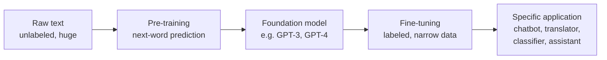
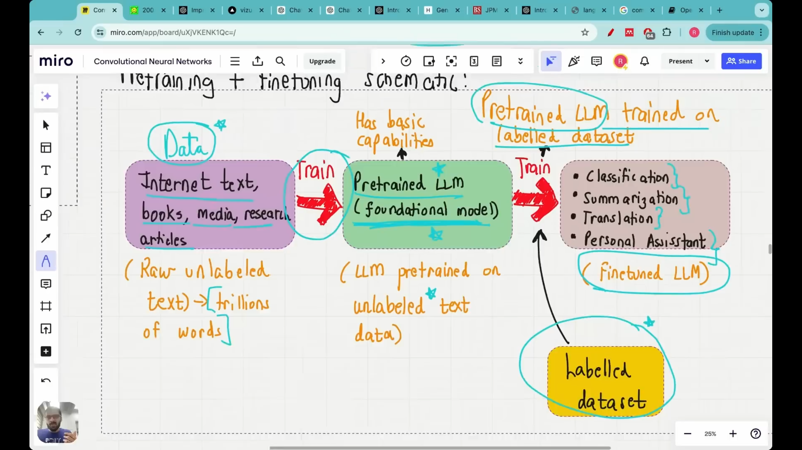

# Lecture 03: Stages of Building an LLM (Pretraining vs Finetuning)

Building an LLM happens in **two stages**: **pre-training** first, then **fine-tuning**. This lecture explains what each one is, why both exist, and what data each one needs. It's all theory with no code. (In this lecture "LLM" is used throughout as shorthand for large language model.)

## If you remember only five things

1. **Pre-training** means training on a huge, diverse dataset. The result is a **foundation (base) model**, and ChatGPT/GPT-4 is a pre-trained model.
2. The pre-training task is just **next-word prediction**, yet the model ends up able to do translation, summarization, Q&A, sentiment analysis and more without being trained on those tasks. That's the main reason LLMs beat older task-specific NLP models.
3. Pre-training is extremely expensive. GPT-3's pre-training cost about **$4.6 million**, so it's out of reach for normal people.
4. **Fine-tuning** takes a pre-trained model and trains it further on a **narrower, specific dataset**, so it works well for one company or domain (telecom, legal, banking).
5. Pre-training uses **unlabeled** (raw) text, while fine-tuning mostly uses **labeled** data. The two main kinds are **instruction fine-tuning** and **classification fine-tuning**.

---

## Stage 1: Pre-training

**Pre-training = training on a large and diverse dataset.**

It answers the question: how can ChatGPT understand what I type, answer so accurately, and respond like a human? The answer is that it was trained on a huge and varied body of data. (The demo in the lecture is simply asking ChatGPT to quiz you on ancient civilizations.) A loose analogy is a child growing up: parents teach them lots of things and they remember them. LLMs perform well for the same reason, which is that they've "been taught" a huge amount.

### How much data? The GPT-3 example

GPT-3 (the predecessor of GPT-4) has **175 billion parameters** and was trained on roughly **300 billion tokens**. For now, treat **1 token ≈ 1 word** (the precise meaning comes in a later lecture). The sources listed in the GPT-3 paper:

| Source       | Roughly how much              | What it is                                                          |
| ------------ | ----------------------------- | ------------------------------------------------------------------- |
| Common Crawl | 410 billion words             | A huge open repository of data from across the internet             |
| WebText2     | ~20 billion words             | Reddit submissions, blog posts, Stack Overflow articles, code, etc. |
| Books        | ~67 billion words (12B + 55B) | Two book collections                                                |
| Wikipedia    | 3 billion words               |                                                                     |

`[check video ~3:34: GPT-3 paper's training data table]`
`[check video ~4:10: the Common Crawl website]`

These add up to more than 300 billion because the 300 billion is what the model actually saw during training, with each source sampled with a different weight. The "60% from Common Crawl" figure is that sampling weight.

### The task: predict the next word

Pre-trained LLMs were originally trained on a very simple task, **word completion**. Given "The lion is in the \_\_\_", the model predicts the missing word, say "forest".

### The surprise: it learns far more than that

Even though the model was only trained to predict the next word, it turned out to be able to do many other things. OpenAI's 2018 pre-training paper noted that the model could start performing tasks **without being trained on them**. For example, accuracy on picking the right answer to a multiple-choice question steadily rises as the underlying language model gets better.

`[check video ~7:00: the OpenAI blog sentence about performing tasks without training on them]`

The list of things it picks up includes translation, answering multiple-choice questions, summarization, sentiment analysis, and linguistic acceptability. This is exactly the difference from older NLP:

- **Old NLP:** want translation? Train a translator. Want a quiz-answering bot? Train another model. Want emotion detection from text? Train another.
- **Pre-trained LLM:** one model does all of these without being trained for each.

Two demonstrations: asking ChatGPT to "generate four MCQs on Egyptian civilization" works even though it was never trained specifically to write MCQs. And Vizuara's own dashboard, where you set one hard, one medium and one easy question, three in total, grade 7, topic photosynthesis, simply makes an **API call to GPT-4** and gets good questions back.

`[check video ~9:12: Vizuara's MCQ generator dashboard]`

So pre-training means training an LLM on a huge amount of data so it can do a wide range of tasks.

---

## Stage 2: Fine-tuning

If GPT-4 is already this capable, why is a second stage needed?

**Because a pre-trained model gives generic answers, built from everything on the internet, and not answers specific to your company or task.**

**Example 1: an airline chatbot.** A user asks about the price of a Lufthansa flight leaving at 6 p.m. The answer you want depends on your company's data. A pre-trained model was trained on a huge amount of general data and may not even have your company's data, so its answer would be generic.

**Example 2: a large education company.** GPT can generate multiple-choice questions, but if you want very high-quality questions, relying on the pre-trained model alone isn't enough. You'd fine-tune it for your use case.

**What fine-tuning is:** a **refinement of pre-training on a much narrower dataset**. Take a bank like JP Morgan with a large amount of non-public data. It takes the pre-trained model, trains it again on its own dataset, and gets a model whose answers are specific to that company.

**Who needs it:** a general user or student can just use GPT-4 and doesn't need fine-tuning. A company deploying LLM applications in the real world, on its own data, does.

### Real examples

`[check video ~13:09: SK Telecom example]`

- **SK Telecom** wanted a chatbot for telecom customer-service conversations **in Korean**. GPT-4 alone isn't suited to this, since its training data probably lacked telecom conversations in Korean. Fine-tuning GPT-4 on its own data gave a **35% increase in conversation-summarization quality** and a **33% increase in intent-recognition accuracy**.

`[check video ~14:02: Harvey example]`

- **Harvey** is an AI legal tool for attorneys. Foundation models were strong at reasoning but lacked **legal case history** and the other knowledge legal work requires. Harvey is a fine-tuned model trained on datasets that include legal case history, which is how it differs from plain GPT-4.

`[check video ~15:57: JP Morgan Chase LLM suite article]`

- **JP Morgan Chase** unveiled its own LLM suite for its employees. GPT-4 already exists, but their data isn't publicly available, so they fine-tuned a model on it.

So across telecom, legal and banking, anything at the production or startup level needs fine-tuning, while plain GPT-4 is fine for students and general use.

> **Terminology:** a pre-trained model is also called a **foundation model** or **base model**. Fine-tuning comes after it. It's called _pre_-training only because fine-tuning exists. It would otherwise simply be called training.

---

## The full picture: three steps

`[check video ~17:29: the pre-training + fine-tuning schematic]`

1. **Data.** Internet text, books, media, research articles. Billions or even trillions of words. No training happens without it.
2. **Pre-training → foundation model.** Training the LLM on that data takes a lot of computational power, i.e. powerful GPUs, energy and money. GPT-3's pre-training cost about **$4.6 million**. The resulting foundation model is already very capable, and ChatGPT/GPT-4 is one.
3. **Fine-tuning → specific application.** Further train the pre-trained model on a labeled dataset to build things like a personal assistant, a translation bot, a summarization assistant or a classification bot.

### Unlabeled vs labeled data

- **Pre-training uses unlabeled data.** It's an **unsupervised** learning task, and it's also called **autoregression**. Part of a sentence is used as input and the next word is the thing to predict. Then the predicted word is added to the input to predict the one after that. (Don't worry about the term for now, it comes back later.)
- **Fine-tuning mostly uses labeled data.** For a spam classifier you provide emails together with labels saying which are spam and which aren't. For Harvey, you provide legal case studies along with the questions and the answers found in each case. That makes it labeled.

---

## The steps for building an LLM, restated

`[check video ~22:15: the whiteboard summarizing the steps]`

1. **Raw text.** Train on a large corpus of text. _Raw text_ is regular text without any labeling information, meaning it doesn't come with predefined labels. It sounds fancy but just means plain unlabeled text.
2. **Pre-training.** The first training stage. It produces the initial pre-trained LLM, also called the base or foundation model. It's capable of text completion, and also turns out capable of many other things (sentiment analysis, question answering, etc.).
3. **Fine-tuning.** The pre-trained LLM is trained further on labeled data. There are two main categories:

**Instruction fine-tuning.** The labeled data is made of **instruction–answer pairs**. For example, a company that translates English to French provides English texts paired with their French versions and uses those to fine-tune the model. Airline customer support works the same way, with a customer's question paired with the correct support response.

**Fine-tuning for classification.** The labeled data is text plus its label. For example, to build an agent that sorts emails into spam and not-spam, you'd give it something like 10,000 emails, 5,000 spam and 5,000 not spam, and fine-tune on that.

Fine-tuning is essential once you go into production and want a powerful model trained on your own data. Companies building their own chatbots almost never use just a foundation model. They do some kind of fine-tuning, which is a further, more expensive step.

---

## What's next

Lecture 04 starts with a basic introduction to **Transformers** and a brief look at the _Attention Is All You Need_ paper. After two to three more lectures on these initial topics, the coding begins.
