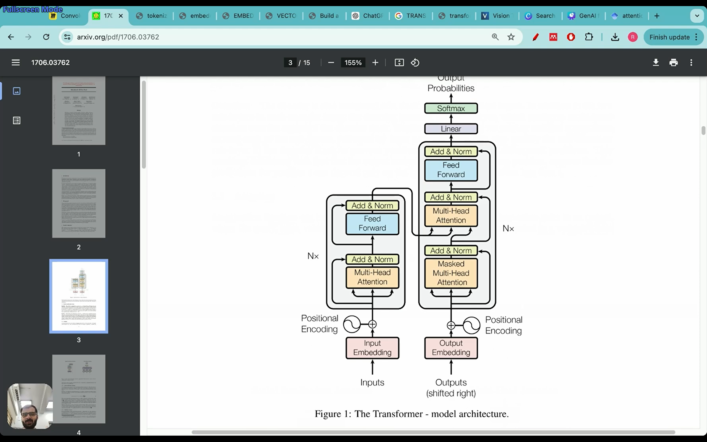
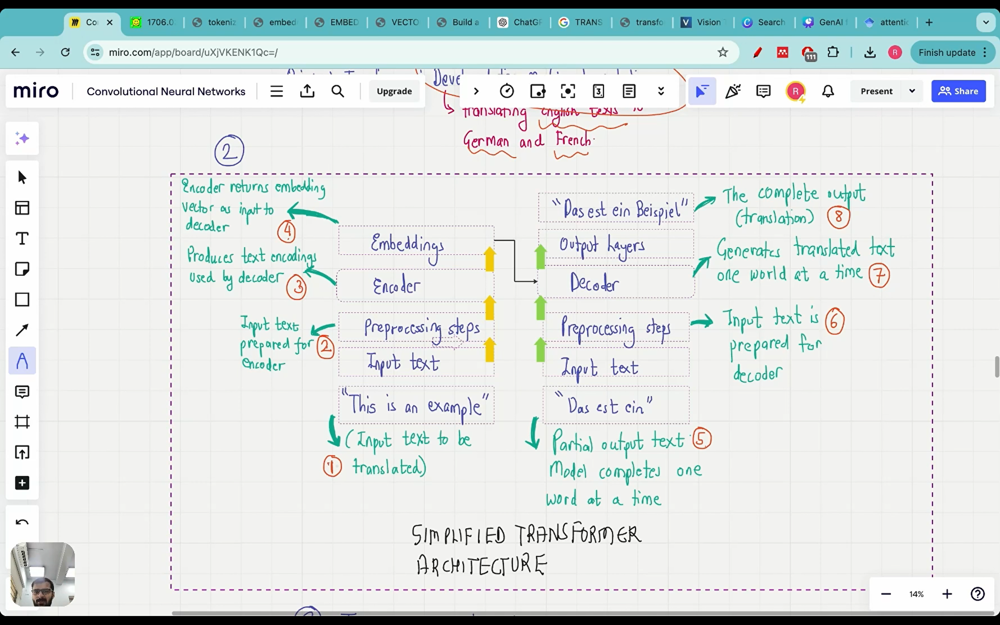
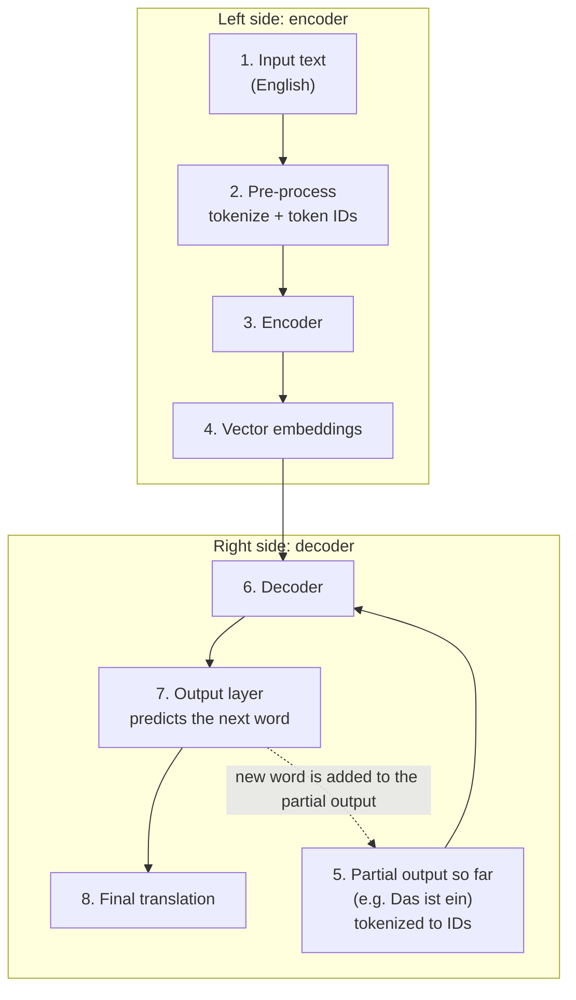
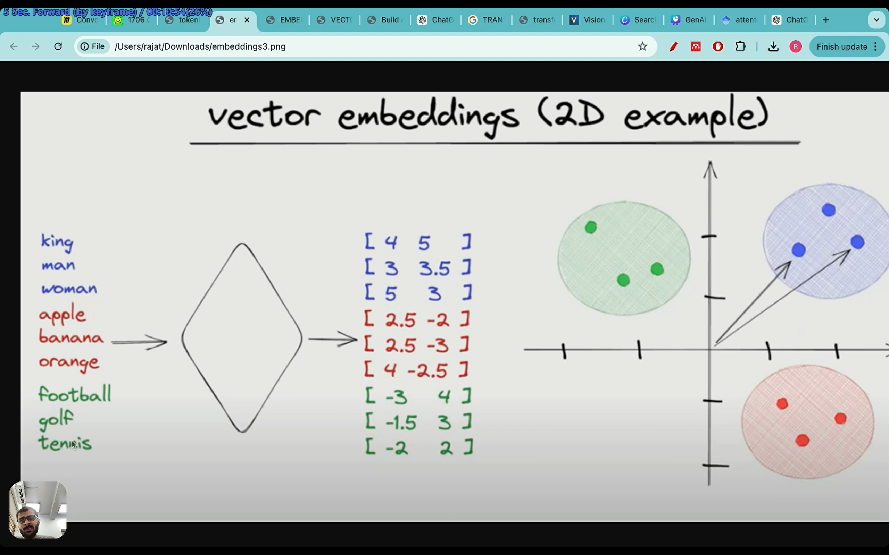
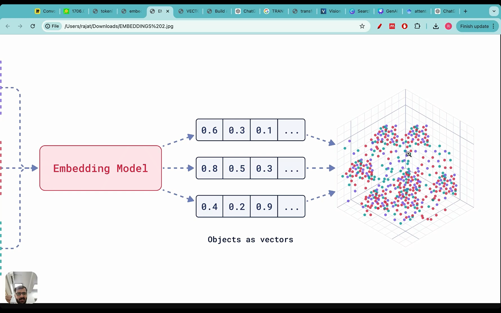
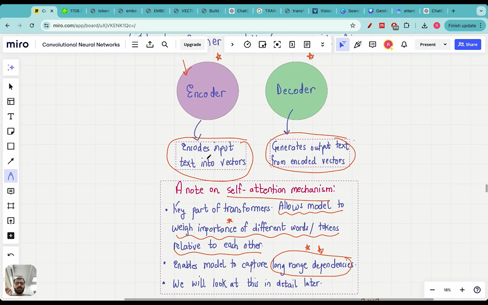

# Lecture 04: What Are Transformers?

A basic introduction to the **transformer** architecture. There's no math and no code here, only the flavor of the idea: what a transformer is, what it did for LLMs, how a simplified one works end to end, the intuition behind attention, how BERT and GPT branched off from it, and whether "transformer" and "LLM" mean the same thing (they don't). Along the way it introduces the basics of **tokenization** and **embeddings**.

## If you remember only five things

1. A **transformer** is a deep neural network architecture from the 2017 paper *Attention Is All You Need*. Most modern LLMs are built on it, and GPT's architecture is heavily based on it (though not identical).
2. The original transformer was built for **machine translation** (English → German and French), not text completion.
3. A simplified transformer has two blocks. The **encoder** turns input tokens into **vector embeddings**, and the **decoder** takes those embeddings plus the **partial output so far** and generates the translation **one word at a time**.
4. **Self-attention** lets the model weigh how important every other word is when it processes or predicts a word, so it can capture **long-range dependencies**. That is the heart of why the paper is titled "Attention Is All You Need".
5. **BERT** is encoder-only and fills in masked words (bidirectional). **GPT** is decoder-only and predicts the next word (left to right). And **not all transformers are LLMs, and not all LLMs are transformers.**

---

## The transformer: what it is and where it came from

Most modern LLMs rely on the **transformer architecture**, which is the secret sauce behind why LLMs are so good. A transformer is a deep neural network architecture introduced in the 2017 paper ***Attention Is All You Need***. The paper has more than 100,000 citations in 6 to 7 years, because so many breakthroughs came from it. The **GPT architecture**, the foundation of ChatGPT, came out of this paper. It isn't exactly the same as the paper's transformer, but it's heavily based on it, which is why it matters so much to understand what the paper did.

The paper is 15 pages long, and every part of its architecture needs its own lecture. Really working through it takes at least 10 to 15 lectures, so this lecture is only the overview.

**An important historical detail:** the original transformer was designed for **translation**, converting one language into another, specifically **English → German** and **English → French**. Text completion, which is what GPT is known for, wasn't even being considered. The mechanism proposed in the paper gave big advances on translation, and only later was it discovered that architectures derived from it could do many other things.

---

## A simplified transformer, in 8 steps

The schematic used here is a toned-down version of the transformer figure, borrowed from Sebastian Raschka's book. If you understand these eight steps, you have the intuition of the transformer. The running example is translating English into German.

### Left side: from text to embeddings (steps 1 to 4)

**Step 1: input text.** The sentence to translate, in English.

**Step 2: pre-processing (tokenization).** Training data is huge (documents full of sentences), and a whole sentence can't be fed into the model as it is. It has to be broken into simpler pieces called **tokens**, and each token is assigned a unique number, a **token ID**. For example, "Fine-tuning is fun for all" is split into small pieces (fine, tuning, is, fun, for, all) and each piece gets an ID. For now it's fine to think of **one word ≈ one token**, but that isn't generally true, and the proper treatment comes later.

**Step 3: the encoder.** The token IDs are passed into the encoder, which performs **vector embedding**.

**Step 4: vector embeddings.** This is the output of the encoder. Why is this step needed? Token IDs are just arbitrary numbers. "Dog" and "puppy" would get unrelated IDs, even though the words are closely related. We need a representation that **captures semantic meaning**, so that related words are represented in a related way.

That is what a **vector embedding** does: each word is converted into a vector, and the vectors are arranged so that related words end up **close together**.

In a 2D illustration, **king, man and woman** form one cluster, **apple, banana and orange** (fruits) form another, and **football, golf and tennis** (sports) form a third. Apple and banana must be closer to each other than banana and king. The vectors can't be placed randomly, since this is a hard task and a neural network is **trained** to do this embedding step. Real embeddings live in a very high-dimensional space, far beyond the 2 or 3 dimensions we can draw, and the arrangement still captures meaning between words.

So the goal of the whole left side is to take input sentences and turn them into vector embeddings that capture the meaning between words. Those embeddings are then fed to the right side.

### Right side: the decoder (steps 5 to 8)

The decoder produces the translation **one word at a time**. It's very important that a transformer (and GPT too) outputs one word per step.

Example: the input is "This is an example", and so far the model has produced **"Das ist ein"**. The translation of "example" hasn't been produced yet, so "Das ist ein" is the **partial output text**. This partial output is available to the model because it only ever generates one output word at a time. By the time it reaches the fourth word, it already has the first three.

**Step 5: the partial output text.** It's tokenized the same way (words → token IDs) before being fed in.

**Step 6: the decoder.** It receives **two things**: the vector embeddings from the left side and the partial output text. From these it has to predict the next word.

**Step 7: the output layer.** The decoder's prediction passes through the output layer, which produces the next word. Here that's **"Beispiel"**, the German for "example".

**Step 8: the final output.** The completed translation: *Das ist ein Beispiel.*

### How does the decoder learn to get it right?

It's a neural network, and it's trained like one. At first it makes mistakes, but there's a **loss function**, and training gradually makes it better. The real transformer schematic contains feed-forward layers, which means weights and parameters that get optimized so the decoder predicts the right German word.

`[check video ~17:04: the full transformer schematic, compared with the simplified one]`

**Don't get intimidated.** Attention hasn't even come up in these eight steps. At its simplest, a transformer is a neural network whose parameters are being optimized. Trying to understand the full architecture directly is where many students get scared, so the simplified version is the right starting point.

---

## The two blocks: encoder and decoder

The transformer has two main blocks:

- **Encoder:** converts the input text into embedding vectors.
- **Decoder:** generates the output text from the embedding vectors plus the partial output it has received.

Keep this in mind for later: the **GPT architecture is different from the original transformer** because it came later and **has no encoder, only a decoder**. That's covered further on.

---

## Self-attention: the key idea

The word "attention" appears 97 times in the paper (checked by searching the page), and it's the reason for the title.

`[check video ~21:07: the paper's definition of attention]`

The paper's definition is hard to digest. Attention mechanisms let you model dependencies **without regard to how far apart the words are** in the input or output sequences. Self-attention relates different positions within a single sequence to compute a representation of that sequence.

**In plain terms: self-attention lets the model weigh the importance of different words (tokens) relative to each other.**

**Example.** Suppose a passage says: sentence 1, Harry Potter is on a station platform; sentence 2, he wants to board the train; and so on. When you're at the fourth sentence and need to predict the next word, the context from sentences 1, 2 and 3 matters. That is a **long-range dependency**: to predict a word you need to know how much attention to give to words that appeared much earlier. Maybe "Harry" deserves a lot of attention. Maybe "platform" or "train" does.

Self-attention captures this. The model maintains **attention scores** (a matrix) that say which words should get more importance, relative to the others, when predicting the next word. It can look far behind as well as at nearby sentences.

**Why it's beautiful.** Humans keep context naturally. When reading a story you remember what was on the previous page. For a model that's very hard, and self-attention is what makes it possible. When you type into ChatGPT, it attends to everything in your input and not just the sentence right before the current one, because words from earlier may be more important.

In the full schematic, this is the role of the **multi-head attention** and **masked multi-head attention** blocks.

`[check video ~24:03: the attention blocks in the full schematic]`

For now, just have the intuition. The math and code come later. You can also think of self-attention as paying attention **in parallel** to different parts of a paragraph or to different sentences.

---

## Later variations: BERT and GPT

The transformer paper came out in 2017. Two families of models were built as variations on it afterwards.

| | **BERT** | **GPT** |
|---|---|---|
| Full form | **B**idirectional **E**ncoder **R**epresentations from **T**ransformers | **G**enerative **P**re-trained **T**ransformer |
| Blocks used | **Encoder only** | **Decoder only** |
| What it does | Predicts **hidden (masked) words** in a sentence | Predicts / generates the **next word** |
| Direction | **Bidirectional**: looks left and right | **Left to right** |
| Known for | Sentiment analysis (its specialty) | Text generation, ChatGPT |

("Pre-trained" in GPT is the same pre-training from the previous lecture, i.e. a foundation model.)

### How BERT works

`[check video ~27:15: the BERT schematic]`

During training, random words in a sentence are **masked** (hidden). For example: *"This is an ___ of how LLM ___ perform."* The text goes through the same pre-processing (token IDs), then the encoder and embedding, and the output is the filled-in blanks, **"example"** and **"can"**, giving "This is an example of how LLM can perform."

Because *any* word can be masked, even the first one, the model has to look at the sentence from **both directions**. That is what "bidirectional" means. By seeing the whole sentence from both sides, BERT can capture nuances and relationships between words. For example, it can tell "bank" as a financial institution from "bank" as a river bank using the surrounding words. This is why BERT is so common in **sentiment analysis**. (GPT can do sentiment analysis too, but it's BERT's specialty.)

### How GPT works

`[check video ~28:08: the GPT schematic]`

GPT receives incomplete text, for example *"This is an example of how LLM can ___"*, and has to produce the **next word**. It does the same pre-processing, then a **decoder** (there is no encoder), and outputs "perform". GPT models learn to **generate one word at a time**.

The big difference: GPT is **left to right**. All the left-hand context is known, and only the rightmost word is unknown. In BERT, random words can be masked, so the model pays attention to different parts of the sentence from both sides.

Both names contain "Transformer" because both come from the original transformer architecture. But BERT keeps only the encoder and GPT keeps only the decoder. Today most of the hype is around GPT and ChatGPT, since it can generate text, complete missing text, and also do sentiment analysis.

---

## Transformers vs LLMs: not the same thing

People use the two terms interchangeably, but they shouldn't. Neither is a subset of the other.

### Not all transformers are LLMs

Transformers are also used outside language, for example in **computer vision**. **Vision Transformers (ViT)** are used for image recognition and classification. Examples shown: detecting a pothole on a road, and classifying tumors as malignant or benign from images. ViTs are compared against CNNs (convolutional neural networks): they achieve strong results while needing substantially fewer computational resources for pre-training. CNNs are what most people think of for image classification, but vision transformers are a newer approach gaining popularity.

`[check video ~31:59: the vision transformer examples (pothole, tumor classification)]`

### Not all LLMs are transformers

Before transformers existed, other architectures already handled sequence modeling and text completion, so they count as language models:

- **RNNs (recurrent neural networks)**, introduced in **1980**. They have a **feedback loop**, which lets them carry memory.
- **LSTMs (long short-term memory networks)**, introduced in **1997**. They use **two separate paths**, one for **long-term memory** and one for **short-term memory**. Using both, they predict what comes next.
- Some **convolutional** architectures can also be language models.

`[check video ~33:36: the timeline image showing RNN (1980) and LSTM (1997) before transformers]`

So LLMs can be based on recurrent or convolutional architectures too, and the two terms should be kept apart.

---

## What's next

Lecture 05 in your folder is "How does GPT-3 really work".
