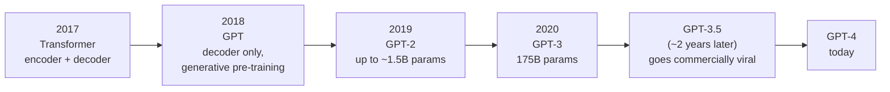
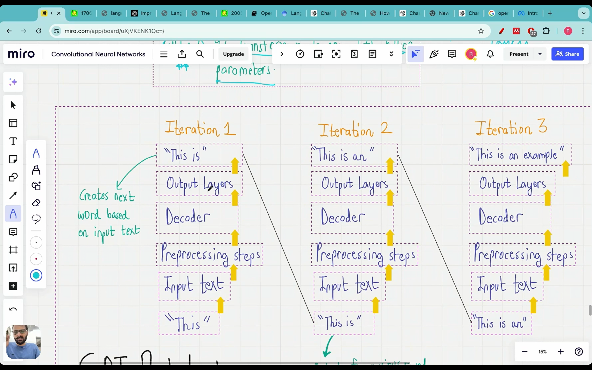
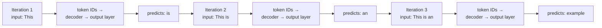

# Lecture 05: How Does GPT-3 Really Work?

This lecture traces how GPT evolved out of the transformer, explains **zero-shot vs few-shot learning**, revisits GPT-3's data and training cost, and then goes into how GPT is actually trained: **unsupervised, autoregressive next-word prediction**. It ends with **emergent behavior**. It's theory only, so there's no code.

## If you remember only five things

1. **Evolution:** Transformer (2017) → GPT (2018) → GPT-2 (2019) → GPT-3 (2020) → GPT-3.5 (the commercial hit) → GPT-4. GPT keeps the transformer idea but is **decoder-only**.
2. **Generative pre-training** means training a language model to predict the next word on a huge amount of **unlabeled** text. The next word in the sentence is the label, so nobody has to label data.
3. **Zero-shot** = the task with no examples. **One-shot** = one example. **Few-shot** = a few examples. GPT-3's paper is titled *Language Models are Few-Shot Learners*, and GPT-4 will tell you it's both.
4. GPT is **autoregressive**: each predicted word is appended to the input and used to predict the next one. GPT-3 has **96 transformer layers**, **175 billion parameters**, was trained on **~300 billion tokens**, and pre-training cost about **$4.6 million**.
5. **Emergent behavior** is the ability to do tasks the model was never explicitly trained for (translation, MCQs, summaries), even though it was only trained to predict the next word.

---

## The evolution: transformer → GPT → GPT-2 → GPT-3 → GPT-4



**2017: *Attention Is All You Need*.** The breakthrough was **self-attention**, which captures long-range dependencies in a sentence and gives much better next-word prediction. It was a significant step beyond RNNs and LSTMs. The original transformer has an **encoder and a decoder**.

**2018: the first GPT paper (generative pre-training).** Up to this point NLP was mostly **supervised learning**, and the paper's argument was that labeled data is scarce, which makes it hard to train models well. Its claim: large gains can be had from **generative pre-training of a language model on a diverse corpus of unlabeled text**. Two phrases matter here: *generative pre-training* and *unlabeled text*.

- They took the transformer, **removed the encoder block**, and trained the language model on a huge dataset **just to predict the next word, with no labels**.
- "Generative" because the training task is generating the next word.
- OpenAI's June 2018 blog post on this described the approach as a combination of two ideas, **transformers and unsupervised pre-training**.
- It was a big deal to researchers, but in 2018 almost nobody outside the research community noticed. It hadn't reached the commercial world yet.

**2019: GPT-2** (*Language Models are Unsupervised Multitask Learners*). More data, and the same generative pre-trained approach. Four sizes were released: **small, medium, large and extra large**. It was the first time a language model had grown this large, and the extra-large one got very good results. (OpenAI was already working on more advanced models by the time this paper came out.)

> **Extra: GPT-2's actual sizes.** The lecture quotes the four GPT-2 sizes as roughly 117M, 345M and 762M, and the largest as "about a billion" parameters. The paper's table lists 117M / 345M / 762M / **1542M**, so the largest is **about 1.5 billion**, not 1 billion. The released checkpoints are commonly quoted as **124M, 355M, 774M and 1.5B**, and that 124M "small" model is the one built later in this series. ([Wikipedia: GPT-2](https://en.wikipedia.org/wiki/GPT-2))

**2020: GPT-3**, "the real boss," with **175 billion parameters**. The paper also released smaller versions (small, medium, large, extra large, and versions with 2.7 billion and 6.7 billion parameters), but the 175B one is what people mean by GPT-3. It was just trained to predict the next word, yet it could do translation, sentiment analysis, question answering, multiple-choice questions and emotion recognition. Nobody had seen a language model this size.

**About 2 years later: GPT-3.5** became commercially viral and everyone started using it. **GPT-4** is where things stand now. In 7 years (2017 to 2024) the field went from the transformer paper to GPT-4.

**GPT vs transformer, once more:** GPT borrows from the transformer architecture, but it **doesn't have the encoder block**.

---

## Zero-shot vs one-shot vs few-shot learning

This distinction shows up constantly in LLM books, articles and blogs. The GPT-3 paper explains it with a translation task:

- **Zero-shot:** the model gets only a **task description**, with no examples. For example, "translate English to French: cheese". If it can do this, that's zero-shot.
- **One-shot:** the task description plus **a single example** of the task.
- **Few-shot:** the task description plus **a few examples** (the paper uses sea otter, peppermint and giraffe).

```text
ZERO-SHOT                       ONE-SHOT                          FEW-SHOT
Translate English to French:    Translate English to French:      Translate English to French:
cheese =>                       sea otter => <French>             sea otter => <French>
                                cheese =>                         peppermint => <French>
                                                                  giraffe => <French>
                                                                  cheese =>
```

Another example of few-shot: to get the model to fix scrambled or misspelled words, give it two examples of a wrong spelling and its correct spelling. Then give a new wrong spelling and it produces the right word (the example in the lecture ends up with "code"). The supporting examples help it do a better job.

> **Extra: few-shot is not fine-tuning.** In few-shot prompting the examples simply go **in the prompt**, and the model's weights are **never updated**. The GPT-3 paper says that for all tasks the model is "applied without any gradient updates or fine-tuning," with tasks and demonstrations specified purely through text. Fine-tuning (Lecture 03) actually changes the weights using labeled data. ([GPT-3 paper abstract](https://arxiv.org/abs/2005.14165))

**What the GPT-3 paper claimed:** they trained GPT-3 (an autoregressive language model, a term explained below) with 175 billion parameters, **10 times more than any previous language model**, and tested it in the few-shot setting. It performed strongly on translation and question answering, and on tasks needing on-the-fly reasoning or domain adaptation, such as unscrambling words, using a novel word in a sentence, and three-digit arithmetic. So GPT-3 is a **few-shot learner**: give it a few examples of a task and it does that task well, even though it was trained only for next-word prediction.

**What about GPT-4?** Asked directly, GPT-4 answers that it's a **few-shot learner** that also handles many tasks **zero-shot**, and that giving examples makes its responses more accurate. Asked again whether it has zero-shot capability, it says yes. The same was true of GPT-3: the authors confidently called it a few-shot learner, and it could do zero-shot too, just less accurately.

**Practical takeaway:** when using GPT, if you show a few examples of the output you want, it does a much better job. Zero-shot works, but few-shot is stronger. Future models will probably get even better at zero-shot.

---

## GPT-3's data and cost

Same data as in the previous lecture, tied to the GPT-3 paper:

| Source | Tokens | Share of training mix |
|---|---|---|
| Common Crawl | 410 billion | 60% |
| WebText2 | 19 billion | 22% |
| Books + Wikipedia | the rest | ~18% |

- **Common Crawl** is a free, open repository of web-crawl data, with over 250 billion pages spanning 17 years, open since 2007.
- **WebText2** is an enhanced version of the original WebText corpus, built from Reddit submissions from 2005 to 2020.
- **Total: ~300 billion tokens.** Adding up the table gives more than 300 billion, and the lecture notes that a different mix must have been used.

> **Extra: why the numbers don't add up.** The "share" column is a **sampling weight**: the fraction of training examples drawn from each dataset, which the paper says it intentionally did *not* make proportional to dataset size. The paper says all models were trained for a total of 300 billion tokens. So Common Crawl is 410B tokens but only 60% of what the model sees. ([GPT-3 paper](https://ar5iv.labs.arxiv.org/html/2005.14165))

**What's a token?** A unit of text the model reads. For now think **1 token ≈ 1 word**, and the real procedure (tokenization) comes in later lectures.

**Cost:** pre-training GPT-3 cost about **$4.6 million**. You need a huge dataset and GPUs to run the model on it, and both are expensive.

**Pre-trained = base = foundation model.** It can then be fine-tuned. The first GPT paper itself describes pre-training followed by fine-tuning. A banking, airline or education company that wants outputs specific to its own data fine-tunes on its own **labeled** data. That needs **less data than pre-training**, and it matters a lot at production level (for example an education company that wants more reliable MCQs, trained on labeled data collected over 5 to 10 years).

As a student you don't need fine-tuning. You can use GPT-3 or GPT-4 directly, for example to extract information or analyze a PDF.

### Open source vs closed source

`[check video ~24:22: the open vs closed source performance graph (MMLU on the y-axis)]`

GPT-4 is **closed source**: its weights and parameters aren't public, and you can only use the end interface. Open-source models existed in 2022 but performed worse (the graph measures performance with MMLU). By August 2024 the gap had closed: **Llama 3.1**, released by Meta, is open source with **405 billion parameters** and performs comparably to GPT-4 (the lecture says slightly better). For students, using GPT-3 or GPT-4 directly is still fine and there's no need to touch weights.

---

## The GPT architecture: decoder only

`[check video ~26:24: the GPT architecture figure vs the original transformer]`

- The **original transformer** has an encoder and a decoder. **GPT has only the decoder block**, so in a sense it's a simpler architecture.
- But it uses far more building blocks. The original transformer had **6 encoder-decoder blocks**, while **GPT-3 has 96 transformer layers** and 175 billion parameters. (One transformer layer is the repeating unit, and GPT-3 stacks 96 of them.)
- GPT-3 is a **scaled-up version** of the original GPT model from the 2018 paper, trained on a larger dataset.

---

## How GPT is trained: unsupervised and autoregressive

GPT models are trained on a single task: **next-word prediction.** "The lion roams in the ___" → "jungle". That's all.

### Unsupervised (self-supervised): the sentence makes its own labels

Each training example is built by splitting a sentence into an **input** (the words so far) and an **output** (always exactly one word, the next word). Example from the lecture, using the sentence "Second law of robotics: a robot must...":

| Input | Predicted next word |
|---|---|
| Second law of robotics: | a |
| Second law of robotics: a | robot |
| Second law of robotics: a robot | must |

The input can be three or four words, but the output is always **one word**. No one supplies labels, since the sentence itself provides them: the **next word is the label**. In other words, labels are made from the **structure of the data itself**. That's why pre-training counts as unsupervised (and the lecture also calls it **self-supervised**, which is the more precise name, since the data effectively supervises itself).

### Autoregressive: previous outputs become inputs

In the table above, notice the word predicted in one row appears in the input of the next row. **The previous output is used as input for the next prediction**, and that's what "autoregressive" means.

### What happens in one training step

1. The model sees the input and predicts the next word. At first the prediction is wrong.
2. Since the true next word is known from the sentence, the **error** between prediction and truth is computed.
3. Like backpropagation in any neural network, the **weights are updated** to reduce that error.

The **175 billion parameters are just the weights of this neural network**. Training means optimizing all of them so the next word is predicted correctly across all sentences.

### Why it takes so much compute

There are billions of sentences. Each one has to be broken into input/output pairs, and the next word predicted for each. Take 410 billion words, around 40 billion sentences of 10 words each, split every one of them up, and then optimize 175 billion parameters over all of it. That is where the $4.6 million goes.

### Generation, iteration by iteration





- **Iteration 1:** the input "This" is converted to token IDs, goes through the decoder and the output layer, and the model predicts **"is"**.
- **Iteration 2:** the input is now "This is". Same steps, and it predicts **"an"**.
- **Iteration 3:** the input is "This is an". It predicts **"example"**, giving "This is an example", and the iterations keep going.

Each prediction informs the input of the next iteration. Note that there is **no encoder anywhere** in this picture, only the decoder.

---

## Emergent behavior

GPT is trained **only** for next-word prediction, yet it can translate languages, generate MCQs, create worksheets and lesson plans, summarize text, create report cards, generate a PPT, grade essays, proofread, and so on. For example, ask it to convert "breakfast" into French and it does, even though it was never trained for translation.

During pre-training it **develops these other capabilities on its own.** That is **emergent behavior**:

> **Emergent behavior = the ability of a model to perform tasks that it wasn't explicitly trained to perform.**

OpenAI's 2018 blog noted that the underlying language model can begin performing tasks without ever training on them, and that accuracy on tasks like picking the right answer to a multiple-choice question steadily rises as the language model improves. It surprised researchers too, because the training task is so simple, and **why this happens is still an open question and an active area of research.** The lecture suggests it as a good topic if you're looking for research directions.

---

## What's next

Lecture 06 covers the stages of building an LLM from scratch, and after that the coding begins, starting from data pre-processing.
