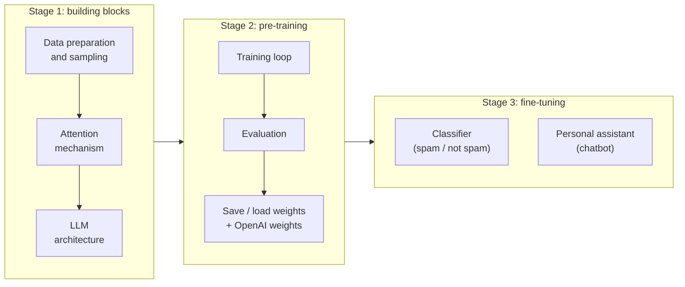
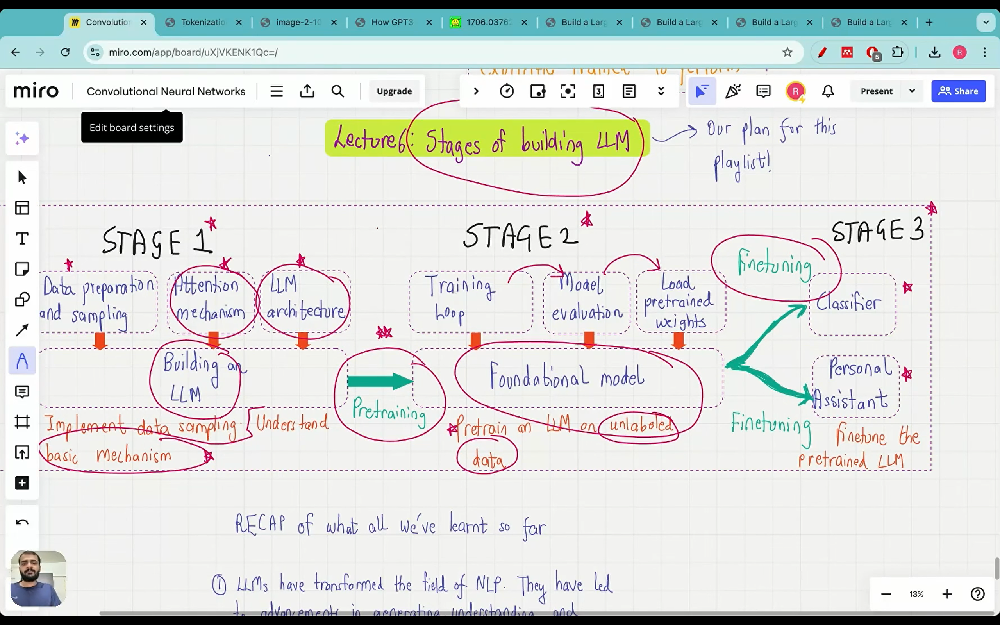

# Lecture 06: Stages of Building an LLM from Scratch

A roadmap lecture. The first five lectures covered theory and intuition (attention, next-word prediction, zero-shot vs few-shot, the transformer, datasets, pre-training vs fine-tuning). This one lays out **what will actually be built from here on**, split into **three stages**, and ends with a recap of Lectures 1 to 5 before the coding starts. The material is heavily borrowed from Sebastian Raschka's book *Build a Large Language Model (From Scratch)*. No code in this lecture.

## If you remember only five things

1. The series is split into **three stages**: **(1) building blocks**, **(2) pre-training**, **(3) fine-tuning**.
2. **Stage 1** has three parts: **data preparation and sampling**, the **attention mechanism**, and the **LLM architecture**. This is where the core mechanics are learned.
3. **Stage 2** is the **training loop** that produces a **foundation model on unlabeled data**, plus evaluation, saving/loading weights, and loading OpenAI's pre-trained weights.
4. **Stage 3** fine-tunes the model into two applications: a **spam classifier** and a **personal-assistant chatbot**.
5. All three stages matter. Skipping straight to stage 3 (deploying apps with LangChain or Llama) leaves gaps in understanding of how any of it works.

---

## Stage 1: the building blocks

Before the model can be trained at all, three things have to be in place: the data has to be prepared and sampled in a very specific way, the attention mechanism has to be understood, and the architecture has to be built.

### 1a. Data preparation and sampling

- **Tokenization.** Break sentences into individual tokens. A token is a unit of a sentence, and there is a particular way of doing the splitting.
- **Vector embeddings.** After tokenization every token must be turned into a vector in a high-dimensional space so that **semantic meaning is captured**: words that mean similar things should sit closer together. In the illustration, apple/banana/orange cluster together (fruits), king/man/woman cluster together, and football/golf/tennis cluster together (sports). These are just representative examples, and the point is that words are encoded *before* the data goes in for training.

  `[check video ~5:07: the embedding figure with the three clusters]`

- **Positional encoding.** The order in which words appear in a sentence matters, and that information has to be given to the model too.
- **Batching.** With a huge dataset, the data is fed to the model in **batches** so computation is efficient. This involves the **next-word prediction task** (given a bunch of words, predict the next one) and the notion of **context**: how many words to take as input when predicting the next output. A data-batching sequence is implemented before the dataset goes into the model for pre-training.

### 1b. The attention mechanism

Understand every part of the transformer's attention blocks: **multi-head attention, masked multi-head attention, positional encoding, input embedding, output embedding.** Along the way: **key, query and value**, and the **attention score**, all coded from scratch in Python.

### 1c. The LLM architecture

Build the model's own architecture: how to **stack layers** on top of each other, where the **attention head** goes, and so on. The aim of the whole stage is to understand the basic mechanism behind a large language model.

---

## Stage 2: pre-training

Once the data is assembled and the architecture is built, write the code that **trains the model on the underlying dataset**. The outcome is a **foundation model trained on unlabeled data**.

`[check video ~7:48: the pre-training schematic from the book (epochs → gradient of loss → update parameters → sample text)]`

- **The training procedure.** The training data is processed over multiple **epochs**. In each one the **gradient of the loss** is computed and the **parameters are updated**. Toward the end, sample text is generated for **visual inspection**.
- **Model evaluation.** Text generation, evaluation, and **training and validation losses**, plus writing the LLM training function.
- **Saving and loading weights.** Functions to save and load the model's weights so you can use the model or **continue training later**. There's no point in training from scratch every time, and saving/loading **saves a ton of compute and memory**.
- **Loading OpenAI's pre-trained weights.** OpenAI has released some pre-trained weights, and these get loaded into our own LLM.

So stage 2 is: training loop + model evaluation + loading pre-trained weights, to build the foundation model.

---

## Stage 3: fine-tuning

The goal of stage 3 is to **fine-tune** the LLM for specific applications. Two are built, both from the book.

**Application 1: a classifier (spam vs not spam).**

`[check video ~9:44: the spam classification schematic]`

Given emails, the model should label them. "You are a winner! You have been specially selected to receive $1,000 cash" should be **spam**, while "Hey, just wanted to check if we're still on for dinner tonight. Let me know." is **not spam**. The pre-trained foundation model alone isn't enough here, because it has to be trained further on **labeled data** that says "this is usually spam and this is not". The result is a **fine-tuned LLM for email classification**.

**Application 2: a personal assistant (chatbot).**

`[check video ~10:39: the instruction / input / output schematic]`

A chatbot that answers queries. The training examples have an **instruction**, an **input** and an **output**, and the model is fine-tuned on these.

**Why all three stages matter.** Many students look only at stage 3: they use LangChain or tools like Llama and deploy applications directly, without understanding stages 1 and 2 at all. That leaves a feeling of not really knowing the nuts and bolts. The plan here is to cover every concept across all three stages without skipping any.

> **Extra: where the three stages land in the repo.** Going by the section headings in the notebooks, the stages map roughly like this:
>
> | Stage | What's covered | Where the code lives |
> |---|---|---|
> | **1a. Data prep** | Tokenization, BPE, input-target pairs, the DataLoader | [1-llmscratch.ipynb](../1-llmscratch.ipynb) |
> | **1b. Attention** | Simplified attention, self-attention with trainable weights, causal attention, multi-head attention | [2-attention_mechanism_and_dataset_prep.ipynb](../2-attention_mechanism_and_dataset_prep.ipynb), sections "Simplified attention" to "Multi-head attention" |
> | **1c. Architecture** | The GPT architecture, built up in parts | Same notebook, the "GPT architecture parts 1 to 7" sections |
> | **2. Pre-training** | Evaluating generative text models, the training loop, decoding strategies (temperature, top-k), loading OpenAI's pre-trained weights | Same notebook, from "Evaluating generative text models" to "Loading pretrained weights from OpenAI" |
> | **3. Fine-tuning** | Classification fine-tuning (spam), instruction fine-tuning | Same notebook, the "Finetuning for classification" and "Instruction fine-tuning" sections |

---

## Recap of Lectures 1 to 5

This recap was given to close out the theory part before the hands-on work begins. It restates the main ideas, all covered in the earlier notes:

- **LLMs transformed NLP.** Before, a separate algorithm was needed for each task. LLMs are generic: train one to predict the next word and it develops **emergent properties**, becoming good at multiple-choice questions, summarization, emotion classification, translation and more.
- **Two-step training.** First **pre-train on unlabeled data** to get a foundation model. This needs billions of words and a lot of money (GPT-3's pre-training cost about $4.6 million), so it takes huge data, compute and money.
- **Then fine-tune** on a smaller, **labeled**, task-specific dataset. Airlines, restaurants, banks and education companies fine-tune before deploying, and nobody deploys the raw pre-trained model. Pre-training labels come from the sentence structure itself (the next word), while fine-tuning uses explicit labels like spam/not spam or good answer/bad answer. **A fine-tuned LLM can outperform a pre-trained-only one on a specific task.** For general student use (doubts, summarization, help writing a paper), GPT-4, Perplexity or similar tools are perfectly fine.
- **The secret sauce is the transformer, and the key idea is attention.** Attention gives the LLM **selective access to the whole input sequence** as it generates one word at a time. It lets the model weigh the importance of words in the current sentence *and* in sentences that came long before, since context matters for predicting the next word.
- **Transformer ≠ GPT.** The original transformer (2017) has an encoder and a decoder. GPT (2018) has **only the decoder**, and so does GPT-4 today. Then came GPT-2 (2019) and GPT-3 (175 billion parameters, which changed the game since nobody had seen a model that large).
- **Emergent behavior.** LLMs are trained only to predict the next word, yet they can classify text, translate and summarize, none of which they were trained to do.

