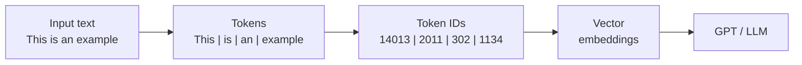
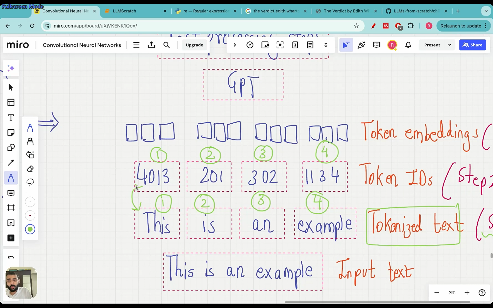
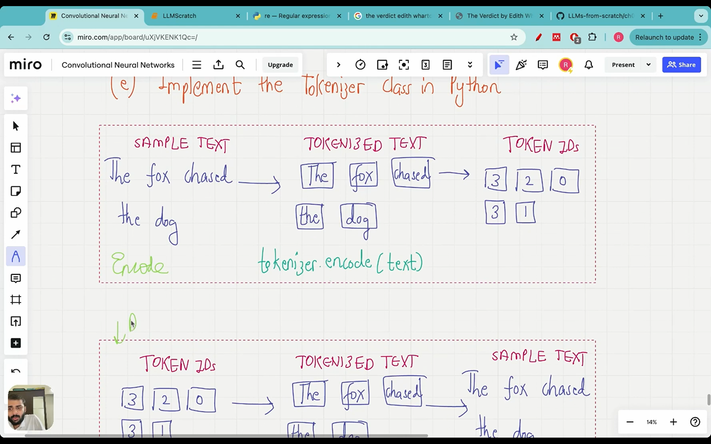

# Lecture 07: Code an LLM Tokenizer from Scratch

## If you remember only five things

1. An LLM can't take raw documents as input. Text is first **tokenized**, then each token is converted to a **token ID**, and only then to vector embeddings (a later lecture).
2. Splitting text into tokens is done with Python's `re.split`: split on whitespace and punctuation, keep the punctuation as its own tokens, drop the whitespace.
3. The **vocabulary** is the sorted list of unique tokens, each mapped to an integer (its token ID). **Encode** goes text → IDs. **Decode** goes IDs → text, using the reverse dictionary.
4. A word that is not in the vocabulary breaks the tokenizer. The fix is **special tokens**: `<|unk|>` for unknown words and `<|endoftext|>` between separate documents.
5. GPT models don't use this word-level scheme. They use **byte pair encoding** (subword tokens), which avoids the unknown-word problem and is the next lecture.

## Where tokenization sits

Data preparation and sampling is the first block of stage 1. The question here is how to prepare input text for training. Training data is billions of documents, but documents or whole sentences are not fed in directly. The pipeline is:



This lecture covers the first two arrows (text → tokens → token IDs). Embeddings come later. The IDs in the schematic are just made-up numbers.



A pre-built tokenizer would have been quicker, but building one by hand shows the details that tokenizers have to deal with.

Reading it in Python: open the file, read it into a string `raw_text`, then check `len(raw_text)`. It comes out to 20,479 characters, and the first 100 characters (`I HAD always thought Jack Gisburn...`) confirm the read worked.

## Step 1: split the text into tokens

The tool is the `re` (regular expression) module.

**Split on whitespace only.** `re.split(r'(\s)', text)` splits wherever there's a whitespace character. The parentheses around `\s` make the split keep the whitespace as list items. But on `"Hello, world. This, is a test."`, the comma and period are still glued to the words (`"Hello,"`, `"world."`).

**Split on punctuation too.** Add the comma and period to the pattern: `r'([,.]|\s)'`. Now `Hello`, `,` and `world`, `.` are separate tokens.

**Drop the whitespace.** The list still has whitespace items. A one-line filter removes them:

```python
result = [item for item in result if item.strip()]
```

`item.strip()` is an empty string (falsy) for whitespace, so those items are filtered out.
**Cover the rest of the punctuation.** The story also has `?`, `!`, quotes, brackets and double dashes `--`, which should all be separate tokens. Final pattern:

```python
result = re.split(r'([,.:;?_!"()\']|--|\s)', text)
result = [item.strip() for item in result if item.strip()]
```

Those two lines are the whole tokenizer. Run on the full story, they give **4,690 tokens**, where words, commas, quotes and `--` each count as one.

**Should whitespace be removed?** It depends on the application. Removing it saves memory and compute. But if the training data is Python code, indentation carries meaning, so whitespace should be kept. Here it's removed for simplicity.

## Step 2: tokens → token IDs

Python works with numbers, so tokens have to become integers.

1. Build the **vocabulary**: take the unique tokens and sort them alphabetically. Using the toy sentence "the quick brown fox jumps over the lazy dog": brown, dog, fox, jumps, lazy, over, quick, the. "the" appears twice in the text but only once in the vocabulary.
2. Give each token an integer in that order, starting from 0: brown = 0, dog = 1, fox = 2, jumps = 3, lazy = 4, over = 5, quick = 6, the = 7. That integer is the **token ID**.

`[check video ~25:01: the vocabulary whiteboard (sorted tokens → IDs)]`

In code:

```python
all_words = sorted(set(preprocessed))
vocab_size = len(all_words)          # 1130
vocab = {token: integer for integer, token in enumerate(all_words)}
```

The vocabulary is a plain dictionary, token → ID. For the story, its size is **1,130**, far smaller than the 4,690 tokens because duplicates collapse. Punctuation sorts first (the first ten or so IDs), then words alphabetically. Some old-fashioned entries (like `Ah`, `Art`) show up because the book is from 1908.

## The tokenizer class: encode and decode

Encoding alone isn't enough. The LLM's output is token IDs, so those have to be turned back into text. That means a second, reverse dictionary (ID → token). The class has three pieces:

- `__init__(vocab)`: stores `str_to_int = vocab` and builds `int_to_str` by flipping the dictionary.
- `encode(text)`: split the text with the same regex, strip whitespace, then look up each token in `str_to_int`.
- `decode(ids)`: look up each ID in `int_to_str`, join the tokens with spaces, then remove the space before punctuation so `chased .` becomes `chased.`.



This encode/decode split mirrors the encoder/decoder idea in the transformer: text goes in as IDs, and output IDs have to be converted back to readable text.

Test on a sentence from the story ("It's the last he painted, you know," Mrs. Gisburn said with pardonable pride.): `encode` returns a list of IDs, and `decode` on those IDs returns the same sentence. Round trip works.

## The problem: words not in the vocabulary

Encode `"Hello, do you like tea?"`. It fails with an error because **"Hello" never appears in the story**, so it has no ID.

This shows why LLMs are trained on large, diverse datasets: a bigger vocabulary means fewer unseen words. But some word will always be missing, and ChatGPT doesn't throw an error when a user types a new word. The mechanism for that is special tokens.

## Special context tokens

Two tokens get added to the vocabulary, as the last two entries (so they get the largest IDs).

**`<|unk|>` (unknown).** Any word not in the vocabulary is replaced by this token instead of raising an error. Example from the whiteboard: if the vocabulary is {chased, dog, fox, the} and the input is "the fox chased the dog quickly", "quickly" gets the ID of `<|unk|>`.

**`<|endoftext|>`.** When training data comes from several independent sources (a book, a news article, an encyclopedia, an interview), they aren't simply concatenated into one blob. An `<|endoftext|>` token goes between them, marking where one text ends and the next starts. Without it, the model would blend unrelated texts together. GPT was trained this way.

`[check video ~46:51: the four text sources separated by end-of-text tokens]`

Code changes:

```python
all_tokens = sorted(list(set(preprocessed)))
all_tokens.extend(["<|endoftext|>", "<|unk|>"])
vocab = {token: integer for integer, token in enumerate(all_tokens)}
```

The vocabulary grows from 1,130 to **1,132**. `<|endoftext|>` has ID **1130** and `<|unk|>` has ID **1131**.

`SimpleTokenizerV2` is identical to V1 except for one extra step in `encode`, which replaces any token not in the vocabulary:

```python
preprocessed = [item if item in self.str_to_int else "<|unk|>" for item in preprocessed]
```

Test: join "Hello, do you like tea?" and "In the sunlit terraces of the palace." with ` <|endoftext|> ` between them and encode. "Hello" and "palace" are both unknown, so both get 1131, and `<|endoftext|>` gets 1130. No error. Decoding gives back `<|unk|>, do you like tea? <|endoftext|> In the sunlit terraces of the <|unk|>.` The tokenizer now handles unseen words, but the original word is lost.

> **Extra:** `<|endoftext|>` only survives as one token here because it's surrounded by spaces and the regex has no rule that splits on `<`, `|` or `>`. If it were glued to a word, the regex wouldn't separate them, and the whole thing would be looked up as one unknown token.

## Other special tokens

- **BOS** (beginning of sequence): marks the start of a text.
- **EOS** (end of sequence): marks the end of a text, like `<|endoftext|>`, useful when joining unrelated texts.
- **PAD** (padding): when training in batches, texts in a batch have different lengths. Shorter ones are padded to match the longest so the batch can be processed in parallel.

GPT models use **none of these except `<|endoftext|>`**, and they don't use `<|unk|>` either.

## Why GPT doesn't need `<|unk|>`: byte pair encoding

GPT models use a **byte pair encoding (BPE)** tokenizer. A word isn't always one token: words not seen before get broken into **subword units** or even single characters, so every input can be represented and there's no unknown token. As a loose illustration, "chased" might be split into pieces like "ch", "as", "ed" (the actual split depends on the BPE vocabulary). The vocabulary built in this lecture treats the whole word as one token. BPE is the next lecture.

## Code

The code for this lecture is in [1-llmscratch.ipynb](../1-llmscratch.ipynb). The notebook starts straight from the top with the file loading and regex cells (no heading). Look for:

- Top of the notebook: reading `the-verdict.txt`, `re.split`, building `vocab`, and `SimpleTokenizerV1`.
- Section **"Adding Special context tokens"**: the extended vocabulary and `SimpleTokenizerV2`.
