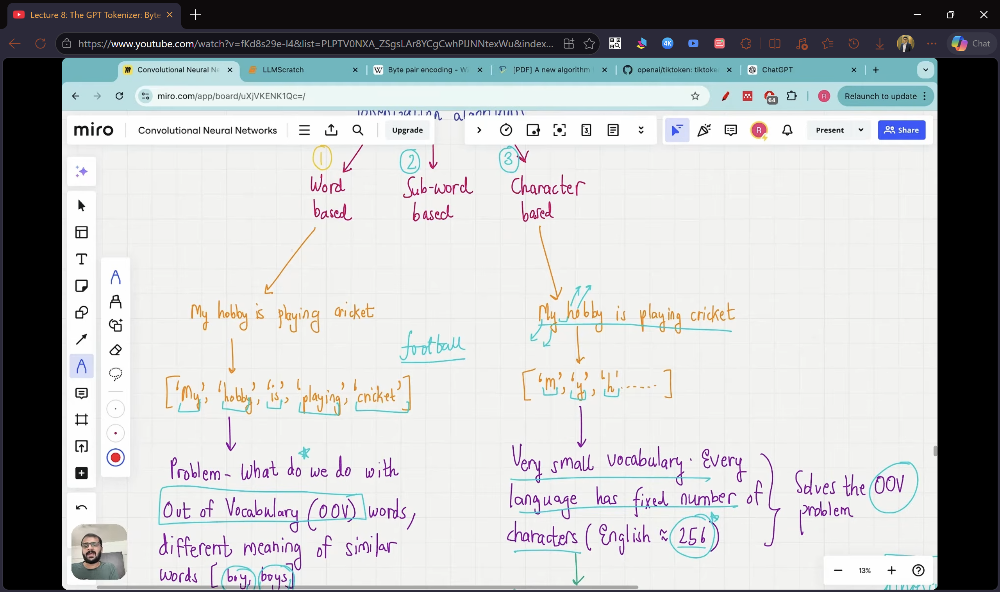

# Lecture 08: The GPT Tokenizer: Byte Pair Encoding

## If you remember only five things

1. Word-level tokenizers break on unseen words and need a huge vocabulary. Character-level tokenizers never fail but lose word meaning and make sequences very long.
2. **Subword tokenization** takes the middle path with two rules: **don't split frequent words**, and **split rare words into meaningful subwords** (down to characters if needed).
3. **Byte pair encoding (BPE)** is a subword algorithm. Repeatedly find the most frequent adjacent pair of tokens, merge it into one new token, and repeat until a stopping point.
4. Merging automatically discovers shared roots and endings. In the lecture's toy corpus it finds `old` and `est</w>` without being told.
5. GPT-2, GPT-3 and the original ChatGPT use BPE with a vocabulary of **50,257** tokens, with `<|endoftext|>` as the last one (ID 50256). Because it can fall back to characters, it never needs an `<|unk|>` token.

## Three kinds of tokenizer


| | Word-based | Character-based | Subword-based (BPE) |
|---|---|---|---|
| Token | whole word | single character | frequent words stay whole, rare words split |
| Vocabulary | huge (English has roughly 170k to 200k words) | tiny | in between (about 50k for GPT-2) |
| Unseen words | error (out-of-vocabulary) | never a problem | never a problem |
| Sequence length | short ("dinosaur" = 1 token) | very long ("dinosaur" = 8 tokens) | in between |
| Word meaning / shared roots | not captured (boy and boys are unrelated tokens) | lost completely | captured |

**Word-based** (what Lecture 07 built). Every word is a token: "my hobby is playing cricket" becomes five tokens. Problems:
- **Out-of-vocabulary words.** If the training data is small and the user types "football", there's no token for it and the tokenizer errors out. It's like preparing for an exam and getting a question you never studied.
- **Huge vocabulary** if every word of a language has to be included.
- **Related words are unrelated.** "boy" and "boys" get separate tokens whose IDs may be far apart, so the shared root is never captured.

**Character-based.** Every character is a token. The vocabulary is tiny and the out-of-vocabulary problem disappears, since any text breaks into known characters. But:
- Meaning attached to words is lost ("boy" vs "boys" is just letters).
- Sequences become much longer than the raw text.

**Subword-based** takes the useful parts of both. Two rules:
1. **Frequently used words are not split.** "boy" appears a lot, so it stays one token (borrowed from word-level).
2. **Rare words are split into smaller meaningful subwords**, down to characters if needed (borrowed from character-level). "boys" becomes `boy` + `s`, since both pieces are common.

What this buys:
- "token", "tokens", "tokenize" share the root `token`, so the model can see they're related.
- "tokenization" and "modernization" share the suffix `ization`, which marks a similar grammatical role.

> **Extra:** the lecture says English has "256 characters". The 256 is actually the number of possible **byte** values. GPT-2's BPE works at the byte level, so its base vocabulary is the 256 byte values, and every other token is a learned merge of existing tokens, plus the special `<|endoftext|>`. This is why any text, in any language, can be encoded with no unknown token. See the [byte discussion in Sebastian Raschka's BPE walkthrough](https://sebastianraschka.com/blog/2025/bpe-from-scratch.html).

## BPE as a compression algorithm

BPE was introduced in **1994** as a **data compression** algorithm. The idea: find the most common pair of consecutive bytes and replace it with a byte that doesn't occur in the data. Repeat.

`[check video ~17:27: the 1994 paper "A New Algorithm for Data Compression"]`

Worked example (taken from Wikipedia). Start with the data `aaabdaaabac`:

1. The pair `aa` is the most frequent (it appears 4 times). Replace it with an unused symbol `Z`: `ZabdZabac`.
2. Now `ab` is the most frequent pair (twice). Replace it with `Y`: `ZYdZYac`.
3. `ac` appears only once and `ZY` appears twice. `ZY` could be replaced with another symbol `W` to give `WdWac`, but nothing else repeats, so the process stops.

`[check video ~17:55: the aaabdaaabac whiteboard example]`

Stopping rule: keep going until no pair occurs more than once.

## BPE for LLMs

For language models the algorithm is tweaked. Instead of replacing a pair with a new unused byte, the pair is **merged into a new token** that gets added to the vocabulary. The result follows the two subword rules: common words end up as single tokens, and rare words stay split into pieces.

### Worked example

The word list (the corpus) with how often each word appears:

| word | frequency |
|---|---|
| old | 7 |
| older | 3 |
| finest | 9 |
| lowest | 4 |

**Preprocessing.** Add an end-of-word marker `</w>` to each word (written `/w` in the lecture), e.g. `old</w>`. This tells the tokenizer where a word ends, which matters later.

**Start.** Split every word into characters and count how often each token appears. With 23 words in total, `</w>` appears 23 times:

| token | count |
|---|---|
| o | 14 |
| l | 14 |
| d | 10 |
| e | 16 |
| r | 3 |
| f | 9 |
| i | 9 |
| n | 9 |
| s | 13 |
| t | 13 |
| w | 4 |
| `</w>` | 23 |

That's 12 tokens. A character-level tokenizer would stop here.

`[check video ~25:35: the frequency table of characters]`

**Merge loop.** Each round: find the most frequent adjacent pair, merge it into one new token, and subtract its count from the two tokens it was built from.

1. **`e` + `s` → `es`** (13 times: 9 in finest, 4 in lowest). Now `e` alone appears 3 times and `s` alone appears 0 times. `s` only ever appears after `e` in this data, which a character-level tokenizer would never reveal.
2. **`es` + `t` → `est`** (13 times). `es` drops to 0.
3. **`est` + `</w>` → `est</w>`** (13 times). The `</w>` is merged in on purpose. Without it, `est` would look the same inside "estimate" and at the end of "highest". With it, the tokenizer knows this token means "`est` at the end of a word".
4. **`o` + `l` → `ol`** (10 times, from old and older).
5. **`ol` + `d` → `old`** (10 times).

`[check video ~28:31: the token table after each merge]`

Other candidates like `f`, `i`, `n` appear 9 times each, but only inside one word ("finest"). Merging them would not give a token that is reused anywhere, so they stay as they are.

**Final vocabulary (11 tokens):** `old`, `est</w>`, `o`, `l`, `e`, `r`, `f`, `i`, `n`, `w`, `</w>`. The counts of the leftover tokens are what remains after subtracting the merges, which is why `s`, `t`, `d`, `es`, `est` and `ol` drop to zero and are removed.

`[check video ~37:05: the final token table]`

How words get split with this vocabulary:
- `old` → `old` + `</w>`
- `older` → `old` + `e` + `r` + `</w>`
- `finest` → `f` + `i` + `n` + `est</w>`
- `lowest` → `l` + `o` + `w` + `est</w>`

So `old` is recognized as the root of both "old" and "older", and `est</w>` as the shared ending of "finest" and "lowest". Neither the word-level nor the character-level tokenizer finds that.

### When to stop

A stopping criterion is needed. Two common choices: stop when the vocabulary reaches a target size, or after a fixed number of merge iterations. For GPT-2 and GPT-3 the run is done on a huge amount of text and ends at a vocabulary of about 50k tokens.

### Why this works well

- **No out-of-vocabulary problem.** Some tokens are single characters (or bytes), so any input can be broken into known pieces.
- **Manageable vocabulary.** About 50k tokens for GPT-2, against 170k to 200k words for a word-level scheme.
- **Roots and suffixes are kept** (`old`, `est</w>`).
- **Shorter sequences than character-level**, since common words are single tokens.

## Code

The code is in [1-llmscratch.ipynb](../1-llmscratch.ipynb), in the section **"BYTE PAIR ENCODING"**. Implementing BPE from scratch is fairly involved, so the notebook uses OpenAI's open-source `tiktoken` library (BPE implemented in Rust) instead.

```python
import tiktoken
tokenizer = tiktoken.get_encoding("gpt2")

text = "Hello, do you like tea? <|endoftext|> In the sunlit terraces of someunknownPlace."
ids = tokenizer.encode(text, allowed_special={"<|endoftext|>"})
tokenizer.decode(ids)      # gives back the same text
```

- `get_encoding("gpt2")` gives an object with `encode` and `decode`, the same interface as `SimpleTokenizerV1/V2` from Lecture 07, in one line.
- `allowed_special={"<|endoftext|>"}` is needed to let the tokenizer treat `<|endoftext|>` as the special token rather than as plain text.
- **`<|endoftext|>` has ID 50256**, the largest ID. The full vocabulary is **50,257** tokens. This is true for GPT-2, GPT-3 and the original ChatGPT model.
- The made-up word `someunknownPlace` is encoded without any error. It is broken into a few subword pieces, and decoding returns the original text exactly.
- Even nonsense like `"Akwirw ier"` encodes and decodes correctly. It is split into whatever subwords and characters exist in the vocabulary (e.g. `er` or `ir` may be common pieces, a lone `w` or `i` a plain character).

No `<|unk|>` token is needed, because anything unfamiliar can be represented as a sequence of subword tokens or characters.
